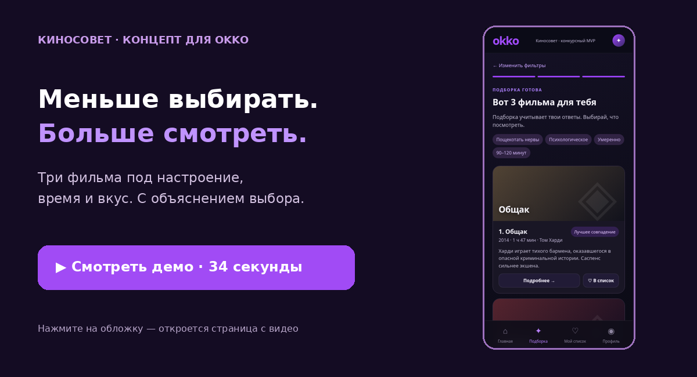

# Киносовет

### AI-киноассистент Okko

**Три варианта вместо бесконечного скролла.**  
Киносовет учитывает настроение, время и вкус — и объясняет каждый выбор.

> Конкурсный концепт рекомендательной функции для Okko. Кликабельные веб- и мобильный прототипы с локальной логикой подбора. Без подключения к модели и реальному каталогу Okko.

## Посмотрите идею в действии

**Начните с 34-секундного демо:** настроение → предпочтения → три фильма → объяснение выбора.

Другие материалы

[Промо-ролик, 15 секунд](https://htmlpreview.github.io/?https://github.com/Vilutfullin/Okko/blob/main/promo.html) · [Скачать скринкаст MP4](mobile-demo.mp4)

---

## Идея

В онлайн-кинотеатр приходят не за каталогом, а за ответом на вопрос: **«Что посмотреть сегодня?»** Большой выбор часто превращается в усталость и откладывание решения.

**Киносовет** превращает расплывчатое настроение в короткий персональный выбор. Пользователь отвечает на несколько вопросов, получает три фильма и видит человеческое объяснение рекомендации.

## Как работает продукт

<table>
<tr><td width="33%"><strong>01 · Контекст</strong> Настроение, время, актёр и допустимый уровень напряжения.</td><td width="33%"><strong>02 · Рекомендация</strong> Локальная логика подбора сопоставляет ответы пользователя с признаками фильмов демонстрационного каталога.</td><td width="33%"><strong>03 · Объяснение</strong> Каждая карточка отвечает на вопрос «почему это подходит мне».</td></tr>
</table>

## Что уже собрано

- desktop-сценарий от первого экрана до оценки фильма;
- мобильный сценарий с сохранением, профилем и обратной связью;
- локальная объяснимая логика ранжирования;
- фильтры по настроению, времени, актёру, типу напряжения и жестокости;
- смена подборки и оценка результата.

## Мой вклад

**Продукт:** гипотеза, сценарий «выбрать фильм на вечер», структура MVP.  
**Логика подбора:** признаки фильма, веса сигналов, объяснения «почему подходит».  
**Прототип:** UX, тексты, desktop/mobile HTML без сборки и зависимостей.

## План проверки гипотезы

1. Провести пользовательское тестирование: предложить участникам выбрать фильм в каталоге и прототипе. Чередовать порядок сценариев, чтобы снизить влияние знакомства с задачей.
2. Проверить три гипотезы:

| Гипотеза | Как проверить |
| --- | --- |
| Подборка сокращает время выбора | Сравнить время до выбора в каталоге и прототипе |
| Три рекомендации помогают определиться | Измерить долю пользователей, выбравших фильм |
| Объяснения повышают доверие | Сравнить оценки рекомендаций с объяснением и без него |

3. Зафиксировать результаты и причины отказа от предложенных фильмов, улучшить сценарий и локальную логику подбора.
4. По результатам проверки решить, какую задачу должна решать AI-модель и нужен ли доступ к реальному каталогу. Подключение AI — возможный следующий этап, а не подтверждённая необходимость.

Результаты пользовательского тестирования пока не получены; числовые улучшения не заявляются.

<strong>Файлы прототипов</strong>
 

- [`okko_ai_prototype.html`](okko_ai_prototype.html) — desktop;
- [`okko_mobile_prototype.html`](okko_mobile_prototype.html) — mobile.

Откройте файл в браузере — внешние библиотеки и сборка не нужны. Каталог демонстрационный. Решение о подключении модели и реального каталога Okko будет принято по результатам проверки гипотезы.

